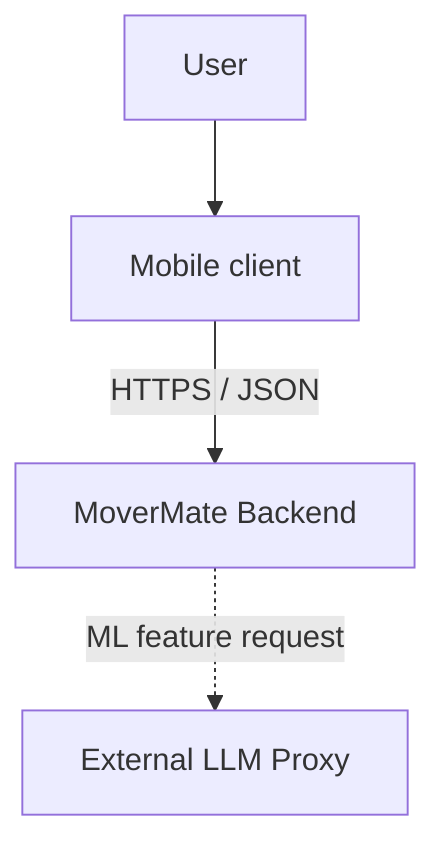
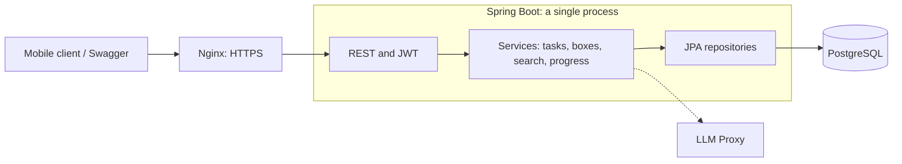
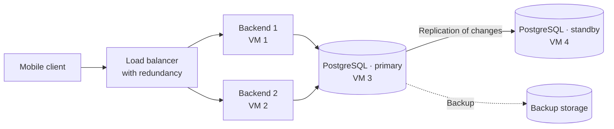
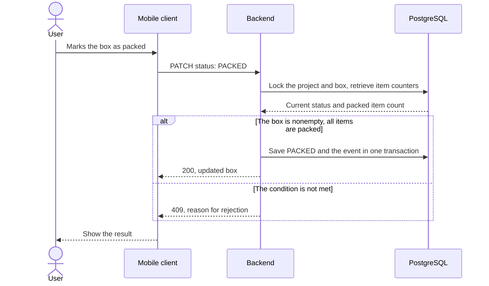
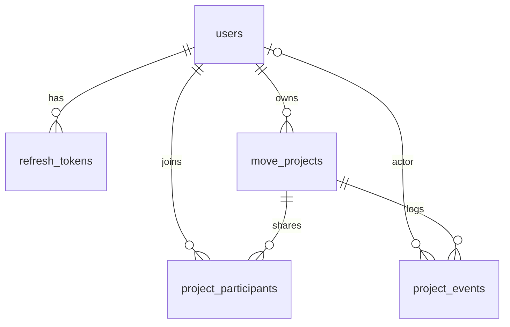
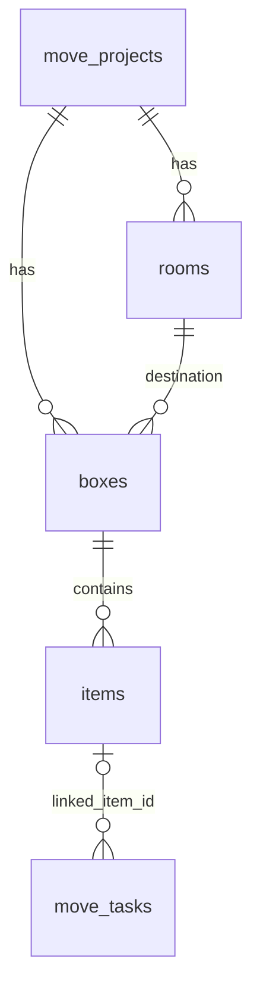
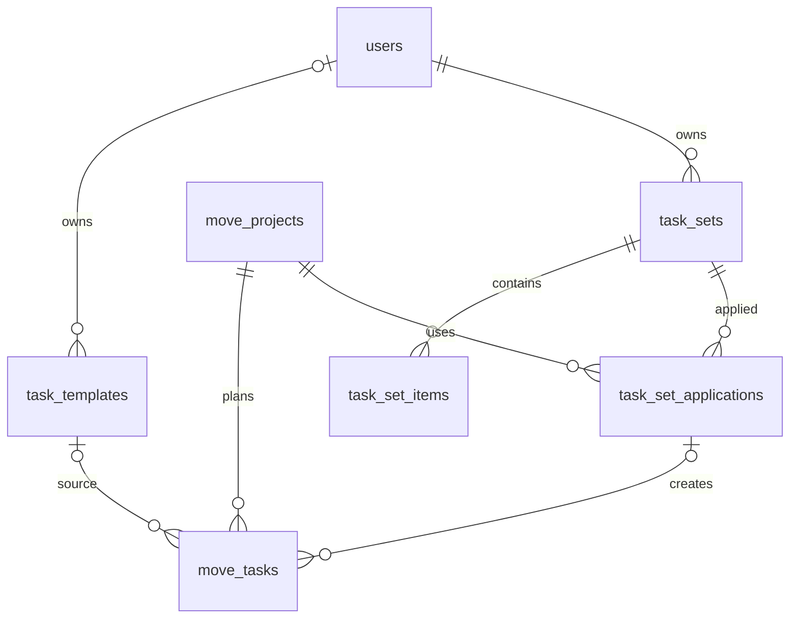
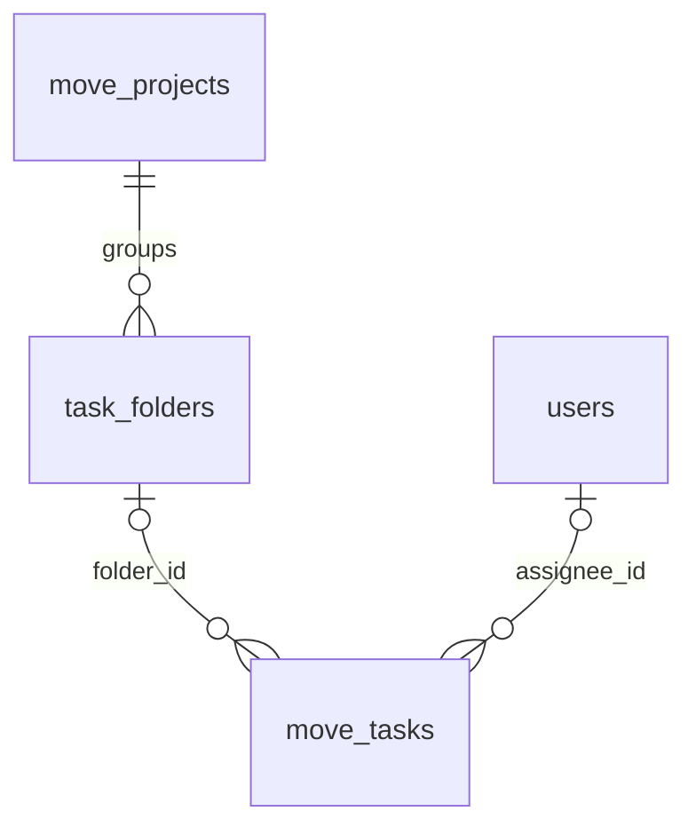
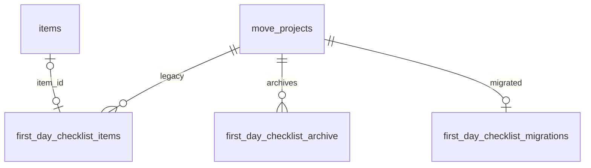

# MoverMate

A service for corporate office and department moves. Employees maintain box inventories, movers mark loading and delivery, and the coordinator tracks overall progress.

## 1. Requirements

### Functional requirements

- **Move plan:** create a project with a name, date, and optional addresses; use predefined tasks or add custom ones; divide tasks into “before”, “on the day”, and “after” stages; specify a deadline and assignee, and mark completion. Group tasks into folders with a name and color, and link tasks to items. Add project participants and assign tasks to them.
- **Boxes:** create boxes with a number unique within the project and a destination room; quickly add items; defer filling in the inventory with a reminder; delete boxes and items with confirmation.
- **Statuses:** “being packed” → “packed” → “loaded” → “delivered” → “unpacked”. Invalid transitions are prohibited.
- **Search and labeling:** search for items by name and boxes by number; show the box, room, and status; create a label with the number, room, and QR code, open a box via QR, and display and print a label or PDF.
- **Tracking:** a loading checklist by room, delivery marks, status counters, and unpacking progress; first-day tasks; marking lost items and suggestions for boxes that have not been unpacked. The first day is managed through regular tasks; the former separate checklist is available only as an archive.
- **Guides:** local materials on packing fragile items, transporting valuables, and items to pack last.
- **Additional:** a room packing plan based on a description or photo (box count, allocation, and packing order), and a box inventory from a photo.

### Nonfunctional requirements

Calculations are based on a corporate move scenario: scanning a QR code reads a card, and marking loading or delivery changes the status. The figures are design assumptions and targets that require verification.

#### MVP

- **Scale:** one corporate move, 200 boxes.
- **DAU:** 100 employees, 5 movers, 1 coordinator — **106 users**.
- **RPS Write:** each of the 5 movers changes the status of one box every 10 seconds: `5 / 10 = 0,5 RPS`.
- **RPS Read:** movers read cards when scanning; each employee checks boxes 5 times over 8 hours, and the coordinator opens progress 20 times: `5 / 10 + (100 × 5 + 20) / (8 × 60 × 60) ≈ 0,52 RPS`.
- **Target availability:** **99.5%**, allowable downtime — **43 h 48 min per year**.

#### Target product

- **Scale:** 100 simultaneous moves of 200 boxes each, with the same participant composition.
- **DAU:** 10,000 employees, 500 movers, 100 coordinators — **10,600 users**.
- **RPS Write:** 500 movers change the status of one box every 10 seconds: `500 / 10 = 50 RPS`.
- **RPS Read:** the same actions for 100 moves: `500 / 10 + (10 000 × 5 + 100 × 20) / (8 × 60 × 60) ≈ 52 RPS`.
- **Target availability:** **99.9%**, allowable downtime — about **8 h 46 min per year**.

## 2. System boundaries

The mobile client handles screens, QR labels, printing, and guides. The backend stores moves and inventories and validates access and status transition rules. Authorization is implemented within the backend. The backend's external call is to an LLM Proxy for additional ML features; core scenarios do not depend on it.

## 3. System components and data flows

### Scaling

To meet the target product requirements — 100 simultaneous moves, approximately 102 RPS, and 99.9% availability — the following is required:

- Deploy two instances of the current Spring Boot application on different VMs. Use a shared database and the same JWT key. Add application instances as load grows further.
- Distribute requests between instances through a redundant load balancer. If one backend fails, route requests to the working one.
- Move PostgreSQL to separate VMs: primary and standby instances with continuous replication of changes. Configure failover to the standby instance if the primary fails, and regular backups for data recovery.
- Update application instances one at a time while continuing to handle requests. Monitor availability, response times, and errors; verify the target load with a load test.

If the primary PostgreSQL instance fails, backend connections switch to the standby instance.
The ML request limit is currently stored in the memory of a single backend; running multiple instances requires a shared counter, for example in Redis.

### Business process diagram: packing a box

The client calls `PATCH /api/projects/{projectId}/boxes/{boxId}/status`. Before transitioning to `PACKED`, the box must contain at least one item, and every item must be marked as packed. Validation and the status change take place in a single transaction.

## 4. API and data model

### API

[Swagger](https://hack-lead-01-ru3-vm1-3a8de1.vmaas-spirit.t-education.com/docs) contains descriptions of every endpoint, request and response models, and error codes and reasons.

### Data model

Relationships are split into small diagrams. Shared tables are repeated across them. An optional foreign key is shown as `o|`.

**Users and access**

**Boxes and items**

An item belongs to one box. A task can reference one item through `linked_item_id`; multiple tasks can reference the same item. The task title is independent of the item, while its box and room in the task response are read from current data. Moving an item preserves the link; deleting an item clears the link while preserving the task. The `items.first_day` flag does not create tasks or change links to them.

**Tasks and templates**

**Folders and assignees**

The folder and assignee are optional. The folder belongs to the same project; the assignee is its creator or a participant. Deleting a folder preserves the tasks without a folder.

**Legacy checklist and archive**

`first_day_checklist_items` is the legacy table; new entries are no longer written to it. Its entries have been migrated to regular tasks; the old API reads an immutable snapshot from `first_day_checklist_archive`, and writes return `410 FIRST_DAY_CHECKLIST_RETIRED`. The UUIDs of items, boxes, rooms, tasks, and folders in the snapshot are historical, with no foreign keys to current records.

Below are **all application tables and their fields**. `timestamptz` means `timestamp with time zone`; `?` indicates that `NULL` is allowed. Primary keys are `id`, or `project_id` for `first_day_checklist_migrations`.

| Table                          | Fields and types                                                                                                                                                                                                                                                                                                                                                                                                                                  |
|----------------------------------|----------------------------------------------------------------------------------------------------------------------------------------------------------------------------------------------------------------------------------------------------------------------------------------------------------------------------------------------------------------------------------------------------------------------------------------------|
| `users`                          | `id uuid`, `email varchar(255)`, `password varchar(255)`, `role varchar(255)`, `first_name varchar(255)?`, `last_name varchar(255)?`                                                                                                                                                                                                                                                                                                         |
| `refresh_tokens`                 | `id uuid`, `user_id uuid`, `refresh_token varchar(64)`, `expiry_at timestamptz`, `created_at timestamptz`                                                                                                                                                                                                                                                                                                                                    |
| `move_projects`                  | `id uuid`, `owner_id uuid`, `name varchar(255)`, `move_date timestamptz`, `origin_address varchar(1000)?`, `destination_address varchar(1000)?`, `archived_at timestamptz?`, `created_at timestamptz`, `updated_at timestamptz`                                                                                                                                                                                                              |
| `project_participants`           | `id uuid`, `project_id uuid`, `user_id uuid`, `added_at timestamptz`                                                                                                                                                                                                                                                                                                                                                                         |
| `rooms`                          | `id uuid`, `project_id uuid`, `name varchar(255)`, `icon_key varchar(64)?`, `created_at timestamptz`, `updated_at timestamptz`                                                                                                                                                                                                                                                                                                               |
| `boxes`                          | `id uuid`, `project_id uuid`, `room_id uuid`, `number integer`, `status varchar(255)`, `contents_deferred boolean`, `title varchar(255)`, `fragile boolean`, `first_day boolean`, `carry_with_me boolean`, `created_at timestamptz`, `updated_at timestamptz`                                                                                                                                                                                |
| `items`                          | `id uuid`, `box_id uuid`, `name varchar(255)`, `quantity integer`, `lost boolean`, `fragile boolean`, `first_day boolean`, `carry_personally boolean`, `packed_at timestamptz?`, `unpacked_at timestamptz?`, `created_at timestamptz`, `updated_at timestamptz`                                                                                                                                                                              |
| `task_templates`                 | `id uuid`, `owner_id uuid?`, `title varchar(255)`, `description varchar(10000)?`, `stage varchar(32)`, `due_date_offset_days integer`, `deleted_at timestamptz?`, `created_at timestamptz`, `updated_at timestamptz`                                                                                                                                                                                                                         |
| `task_sets`                      | `id uuid`, `owner_id uuid`, `name varchar(255)`, `description varchar(10000)?`, `deleted_at timestamptz?`, `created_at timestamptz`, `updated_at timestamptz`                                                                                                                                                                                                                                                                                |
| `task_set_items`                 | `id uuid`, `task_set_id uuid`, `title varchar(255)`, `description varchar(10000)?`, `stage varchar(32)`, `offset_days integer`, `position integer`                                                                                                                                                                                                                                                                                           |
| `task_set_applications`          | `id uuid`, `project_id uuid`, `task_set_id uuid`, `task_set_name varchar(255)`, `folder_id uuid?`, `applied_at timestamptz`                                                                                                                                                                                                                                                                                                                  |
| `task_folders`                   | `id uuid`, `project_id uuid`, `name varchar(80)`, `color_key varchar(16)`, `initial_name varchar(80)`, `initial_color_key varchar(16)`, `created_at timestamptz`, `updated_at timestamptz`                                                                                                                                                                                                                                                   |
| `move_tasks`                     | `id uuid`, `project_id uuid`, `template_id uuid?`, `task_set_application_id uuid?`, `task_set_position integer?`, `folder_id uuid?`, `assignee_id uuid?`, `linked_item_id uuid?`, `title varchar(255)`, `description varchar(10000)?`, `stage varchar(32)`, `due_date date?`, `due_type varchar(16)`, `offset_days integer?`, `assignee_name varchar(255)?`, `completed_at timestamptz?`, `created_at timestamptz`, `updated_at timestamptz` |
| `first_day_checklist_items`      | `id uuid`, `project_id uuid`, `item_id uuid?`, `name varchar(255)`, `completed_at timestamptz?`, `created_at timestamptz`, `updated_at timestamptz`                                                                                                                                                                                                                                                                                          |
| `first_day_checklist_archive`    | `id uuid`, `project_id uuid`, `target_task_id uuid`, `folder_id uuid`, `name varchar(255)`, `completed_at timestamptz?`, `created_at timestamptz`, `updated_at timestamptz`, `item_id uuid?`, `item_name varchar(255)?`, `box_id uuid?`, `box_number integer?`, `room_id uuid?`, `room_name varchar(255)?`, `room_icon_key varchar(255)?`                                                                                                    |
| `first_day_checklist_migrations` | `project_id uuid`, `folder_id uuid`, `source_count bigint`, `completed_count bigint`, `migrated_at timestamptz`                                                                                                                                                                                                                                                                                                                              |
| `project_events`                 | `id uuid`, `project_id uuid`, `actor_id uuid?`, `event_type varchar(32)`, `object_type varchar(32)`, `object_id uuid`, `description varchar(2000)`, `previous_status varchar(32)?`, `new_status varchar(32)?`, `occurred_at timestamptz`                                                                                                                                                                                                     |

Key database constraints: `users.email`, `boxes(project_id, number)`, `rooms(project_id, name)`, and `project_participants(project_id, user_id)` are unique. Composite foreign keys prevent linking a box to a room from another move or a task to a folder from another project. Deleting a folder preserves the tasks without a folder; deleting an item removes task links to it.

The first-day archive stores an immutable snapshot, and `first_day_checklist_migrations` prevents migrating old entries to tasks more than once. In both tables, only `project_id` has a foreign key; the other UUIDs are historical. `task_set_applications.folder_id` and `project_events.object_id` are also stored without a foreign key.

## 5. Choice of specific technologies

### Backend

| Technology | Reason |
| --- | --- |
| Java 17, Spring Boot 4, Spring Security + JWT | A single deployable service; access to projects is checked on the server. |
| PostgreSQL, JPA, Liquibase | Transactions, uniqueness constraints, data persistence, and schema versioning. |
| Springdoc OpenAPI | A verifiable contract and interactive Swagger. |
| Docker Compose, GitLab CI | Automated tests, image, deployment, and readiness/OpenAPI checks. |
| JUnit, Testcontainers, JaCoCo | Integration scenarios on PostgreSQL and coverage reports. |
| **Spring Boot Actuator** | Publishing technical metrics and application health checks. |
| **Micrometer** | Collecting HTTP request, JVM, connection pool, and custom API and LLM operation metrics. |
| **Prometheus Registry (`micrometer-registry-prometheus`)** | Exporting metrics in Prometheus format through a protected endpoint for collection by an external monitoring system. |
| **Sage** | Collecting backend metrics and monitoring scrape availability, API load, and other technical indicators. |
| **Grafana** | Dashboards for analyzing load, latency, API errors, JVM memory, and technical LLM failures. |

### Mobile application

| Technology | Reason for choosing it |
| --- | --- |
| **Kotlin 2.3.21, Android SDK** | A native Android application; strong typing, null safety, and support for platform features. |
| **Jetpack Compose, Material 3** | A declarative interface, reusable components, adaptive layout, and support for light and dark themes. |
| **MVVM, presentation / domain / data separation** | Separation of the interface, business rules, and data handling; independent testing of layers. |
| **Coroutines, Flow / StateFlow** | Asynchronous requests, operation cancellation, and reactive interface updates. |
| **AndroidX ViewModel, SavedStateHandle** | Managing screen state and restoring important parameters and unfinished operations. |
| **Navigation Compose** | Typed routes, screen stack management, and handling external links to boxes. |
| **Hilt / Dagger, KSP** | Dependency injection and generation of glue code with compile-time checking. |
| **Ktor 3.6, OkHttp, Ktorfit 2.7.5** | An HTTP client, declarative API interfaces, photo uploads, and unified network request handling. |
| **Kotlinx Serialization** | Converting JSON into typed request and response models. |
| **JWT, access / refresh tokens** | Request authorization, session restoration, and token renewal. |
| **Android Keystore, AES-GCM** | Encrypted token storage; the encryption key is stored using Android facilities. |
| **File-based JSON cache, SharedPreferences** | Persisting catalog snapshots and user settings between launches. |
| **CameraX 1.6.2, ZXing 3.5.3** | Capturing camera frames, automatic QR recognition, and generating codes for labels. |
| **Activity Result API, Photo Picker / GetContent, FileProvider** | Taking and selecting photos, handling permissions, and securely sharing files. |
| **Coil 2.7, AndroidSVG** | Loading images and displaying SVG icons and illustrations. |
| **Lottie Compose, Compose Animation** | Animated illustrations, transitions, mascot reactions, and loading states. |
| **Unbounded, Inter** | Expressive headings and readable body text within a unified visual system. |
| **Android PdfDocument, Printing Framework, Storage Access Framework** | Creating PDF labels, system printing, and saving documents to a selected location. |
| **AlarmManager, notifications, BroadcastReceiver** | Local inventory reminders and restoring the schedule after the device restarts. |
| **REST API, multipart/form-data** | Integration of server-side AI: sending photos and descriptions, receiving suggestions for the inventory and room plan. |
| **JUnit 4, Robolectric, Compose UI Test, Ktor MockEngine** | Testing business scenarios, screen state, user actions, and network contracts. |
| **Roborazzi, Compose Preview Scanner** | Screenshot tests of the interface on the JVM, including themes, large fonts, and significant screen states. |
| **Android Lint, ktfmt, Tree-sitter-based anti-bloat** | Static analysis, consistent formatting, and checks for duplication and excessive code. |
| **Gradle 9.6, Kotlin DSL, AGP 9.4.1, JDK 21** | Building modules, generating code, managing dependencies, and running checks. |
