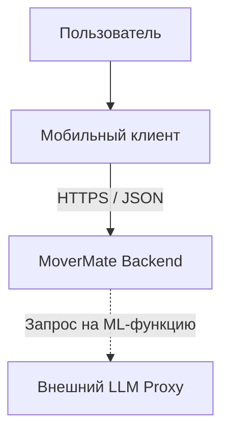
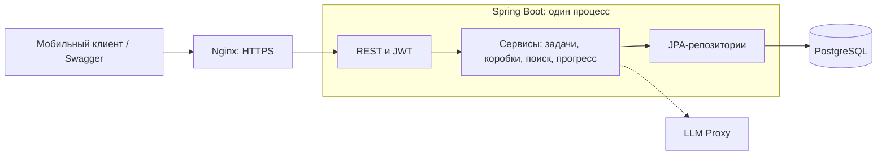
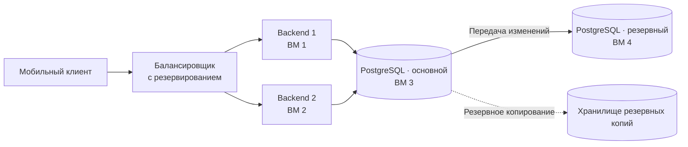
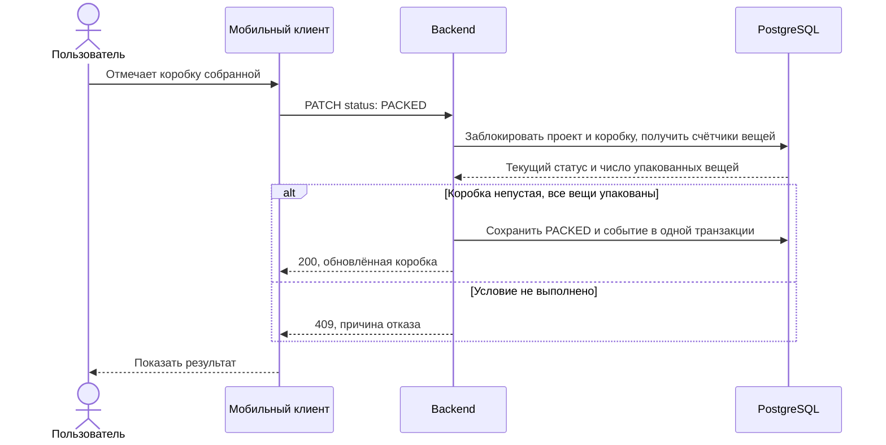
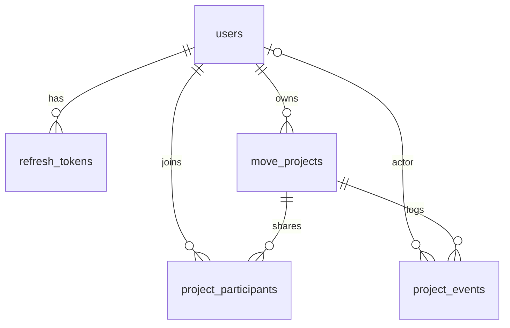
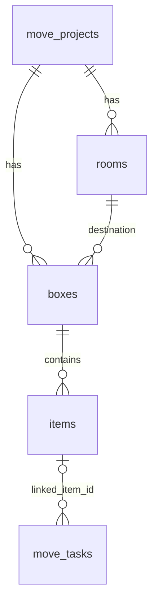
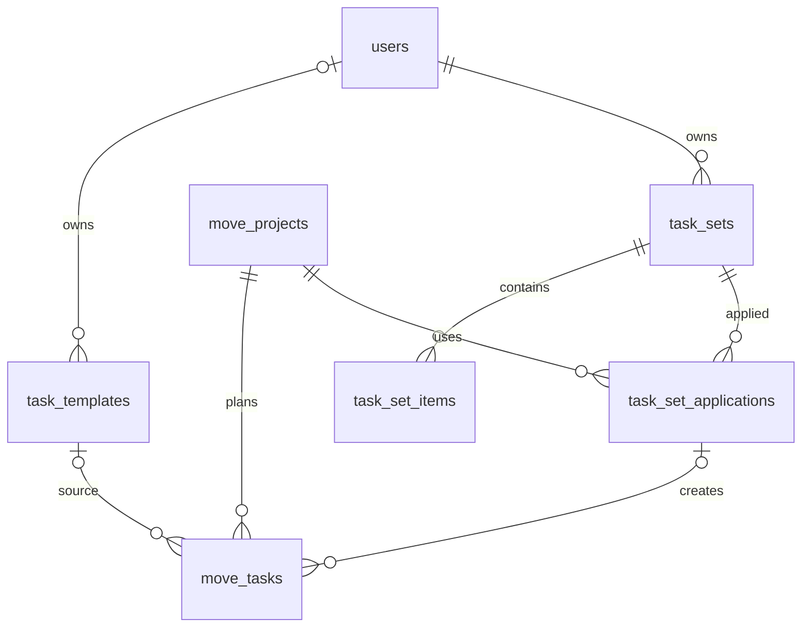
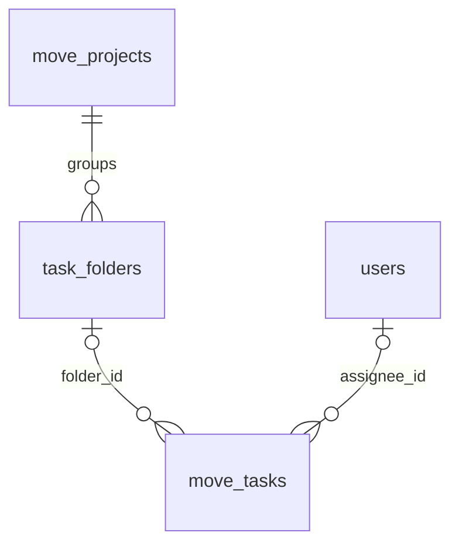
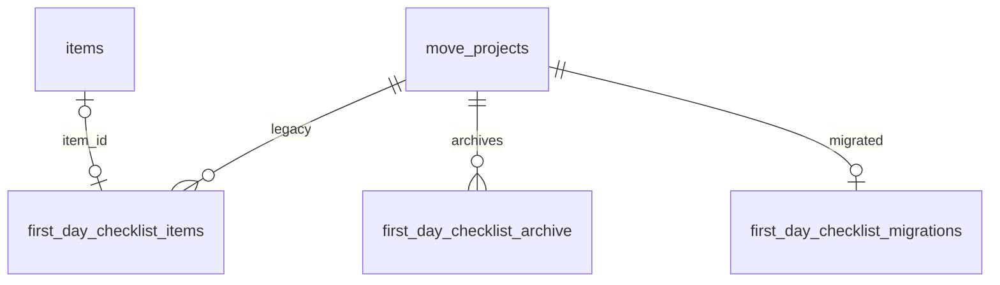

# MoverMate

Сервис для корпоративных переездов офисов и отделов. Сотрудники ведут опись коробок, перевозчики отмечают погрузку и доставку, координатор отслеживает общий прогресс.

## 1. Требования

### Функциональные требования

- **План переезда:** создать проект с названием, датой и необязательными адресами; использовать готовые задачи или добавить свои; разделить задачи на этапы «до», «в день» и «после»; указать срок и ответственного, отмечать выполнение. Объединять задачи в папки с названием и цветом, связывать задачи с вещами. Добавлять участников проекта и назначать им задачи.
- **Коробки:** создавать коробки с уникальным в проекте номером и комнатой назначения; быстро добавлять вещи; откладывать заполнение описи с напоминанием; удалять коробки и вещи с подтверждением.
- **Статусы:** «собирается» → «собрана» → «погружена» → «доставлена» → «распакована». Недопустимые переходы запрещены.
- **Поиск и маркировка:** искать вещи по названию и коробки по номеру; показывать коробку, комнату и статус; создавать этикетку с номером, комнатой и QR, открывать коробку по QR, показывать и печатать этикетку или PDF.
- **Контроль:** чек-лист погрузки по комнатам, отметки доставки, счётчики статусов и прогресс распаковки; задачи первого дня; отметка потерянных вещей и подсказки по нераспакованным коробкам. Первый день ведётся обычными задачами; прежний отдельный чек-лист доступен только как архив.
- **Памятки:** локальные материалы об упаковке хрупкого, перевозке ценностей и вещах, которые упаковывают последними.
- **Дополнительно:** план упаковки комнаты по описанию или фото (количество коробок, распределение и порядок упаковки), опись коробки по фото.

### Нефункциональные требования

Расчёт по сценарию корпоративного переезда: сканирование QR читает карточку, отметка погрузки или доставки меняет статус. Числа — проектные допущения и цели, требующие проверки.

#### MVP

- **Масштаб:** один корпоративный переезд, 200 коробок.
- **DAU:** 100 сотрудников, 5 грузчиков, 1 координатор — **106 пользователей**.
- **RPS Write:** каждый из 5 грузчиков меняет статус одной коробки раз в 10 секунд: `5 / 10 = 0,5 RPS`.
- **RPS Read:** грузчики читают карточки при сканировании; каждый сотрудник проверяет коробки 5 раз за 8 часов, координатор открывает прогресс 20 раз: `5 / 10 + (100 × 5 + 20) / (8 × 60 × 60) ≈ 0,52 RPS`.
- **Целевая доступность:** **99,5%**, допустимый простой — **43 ч 48 мин в год**.

#### Целевой продукт

- **Масштаб:** 100 одновременно проходящих переездов по 200 коробок, с тем же составом участников.
- **DAU:** 10 000 сотрудников, 500 грузчиков, 100 координаторов — **10 600 пользователей**.
- **RPS Write:** 500 грузчиков меняют статус одной коробки раз в 10 секунд: `500 / 10 = 50 RPS`.
- **RPS Read:** те же действия для 100 переездов: `500 / 10 + (10 000 × 5 + 100 × 20) / (8 × 60 × 60) ≈ 52 RPS`.
- **Целевая доступность:** **99,9%**, допустимый простой — около **8 ч 46 мин в год**.

## 2. Границы системы

Мобильный клиент отвечает за экраны, QR-этикетки, печать и памятки. Backend хранит переезды и опись, проверяет доступ и правила изменения статусов. Авторизация реализована внутри backend. Внешний вызов backend — LLM Proxy для дополнительных ML-функций; основные сценарии от него не зависят.

## 3. Компоненты системы и потоки данных

### Масштабирование

Для реализации требований целевого продукта — 100 одновременных переездов, около 102 RPS и доступность 99,9% — необходимо:

- Развернуть два экземпляра текущего Spring Boot-приложения на разных ВМ. Использовать общую БД и одинаковый ключ JWT. При дальнейшем росте добавлять экземпляры приложения.
- Распределять запросы между экземплярами через балансировщик с резервированием. При отказе одного backend направлять запросы на работающий.
- Вынести PostgreSQL на отдельные ВМ: основной и резервный экземпляры с постоянной передачей изменений. Настроить переключение на резервный экземпляр при отказе основного и регулярные резервные копии для восстановления данных.
- Обновлять экземпляры приложения по очереди, сохраняя обработку запросов. Отслеживать доступность, время ответа и ошибки; подтвердить целевую нагрузку нагрузочным тестом.

При отказе основного PostgreSQL подключения backend переключаются на резервный экземпляр.
Лимит ML-запросов сейчас хранится в памяти одного backend; при запуске нескольких экземпляров нужен общий счётчик, например в Redis.

### Схема бизнес-процесса: сборка коробки

Клиент вызывает `PATCH /api/projects/{projectId}/boxes/{boxId}/status`. Перед переходом в `PACKED` коробка должна содержать хотя бы одну вещь, а каждая вещь — иметь отметку упаковки. Проверка и изменение статуса выполняются в одной транзакции.

## 4. API и модель данных

### API

[Swagger](https://hack-lead-01-ru3-vm1-3a8de1.vmaas-spirit.t-education.com/docs) содержит описание каждого эндпоинта, модели запросов и ответов, коды и причины ошибок.

### Модель данных

Связи разделены на небольшие схемы. Общие таблицы повторяются между ними. Необязательный внешний ключ показан как `o|`.

**Пользователи и доступ**

**Коробки и вещи**

Вещь принадлежит одной коробке. Задача может ссылаться на одну вещь через `linked_item_id`; на одну вещь могут ссылаться несколько задач. Название задачи независимо от вещи, а её коробка и комната в ответе задачи читаются из актуальных данных. Перенос вещи сохраняет связь; удаление вещи очищает связь, сохраняя задачу. Метка `items.first_day` не создаёт задачи и не меняет связи с ними.

**Задачи и шаблоны**

**Папки и ответственные**

Папка и ответственный необязательны. Папка принадлежит тому же проекту, ответственный — его создатель или участник. Удаление папки сохраняет задачи без папки.

**Прежний чек-лист и архив**

`first_day_checklist_items` — прежняя таблица, новые пункты в неё не записываются. Её пункты перенесены в обычные задачи; старый API читает неизменяемый снимок из `first_day_checklist_archive`, запись возвращает `410 FIRST_DAY_CHECKLIST_RETIRED`. UUID вещей, коробок, комнат, задач и папок в снимке исторические, без внешних ключей к актуальным записям.

Ниже перечислены **все таблицы приложения и их поля**. `timestamptz` означает `timestamp with time zone`; `?` — допускаемый `NULL`. Первичные ключи — `id`, у `first_day_checklist_migrations` — `project_id`.

| Таблица | Поля и типы |
| --- | --- |
| `users` | `id uuid`, `email varchar(255)`, `password varchar(255)`, `role varchar(255)`, `first_name varchar(255)?`, `last_name varchar(255)?` |
| `refresh_tokens` | `id uuid`, `user_id uuid`, `refresh_token varchar(64)`, `expiry_at timestamptz`, `created_at timestamptz` |
| `move_projects` | `id uuid`, `owner_id uuid`, `name varchar(255)`, `move_date timestamptz`, `origin_address varchar(1000)?`, `destination_address varchar(1000)?`, `archived_at timestamptz?`, `created_at timestamptz`, `updated_at timestamptz` |
| `project_participants` | `id uuid`, `project_id uuid`, `user_id uuid`, `added_at timestamptz` |
| `rooms` | `id uuid`, `project_id uuid`, `name varchar(255)`, `icon_key varchar(64)?`, `created_at timestamptz`, `updated_at timestamptz` |
| `boxes` | `id uuid`, `project_id uuid`, `room_id uuid`, `number integer`, `status varchar(255)`, `contents_deferred boolean`, `title varchar(255)`, `fragile boolean`, `first_day boolean`, `carry_with_me boolean`, `created_at timestamptz`, `updated_at timestamptz` |
| `items` | `id uuid`, `box_id uuid`, `name varchar(255)`, `quantity integer`, `lost boolean`, `fragile boolean`, `first_day boolean`, `carry_personally boolean`, `packed_at timestamptz?`, `unpacked_at timestamptz?`, `created_at timestamptz`, `updated_at timestamptz` |
| `task_templates` | `id uuid`, `owner_id uuid?`, `title varchar(255)`, `description varchar(10000)?`, `stage varchar(32)`, `due_date_offset_days integer`, `deleted_at timestamptz?`, `created_at timestamptz`, `updated_at timestamptz` |
| `task_sets` | `id uuid`, `owner_id uuid`, `name varchar(255)`, `description varchar(10000)?`, `deleted_at timestamptz?`, `created_at timestamptz`, `updated_at timestamptz` |
| `task_set_items` | `id uuid`, `task_set_id uuid`, `title varchar(255)`, `description varchar(10000)?`, `stage varchar(32)`, `offset_days integer`, `position integer` |
| `task_set_applications` | `id uuid`, `project_id uuid`, `task_set_id uuid`, `task_set_name varchar(255)`, `folder_id uuid?`, `applied_at timestamptz` |
| `task_folders` | `id uuid`, `project_id uuid`, `name varchar(80)`, `color_key varchar(16)`, `initial_name varchar(80)`, `initial_color_key varchar(16)`, `created_at timestamptz`, `updated_at timestamptz` |
| `move_tasks` | `id uuid`, `project_id uuid`, `template_id uuid?`, `task_set_application_id uuid?`, `task_set_position integer?`, `folder_id uuid?`, `assignee_id uuid?`, `linked_item_id uuid?`, `title varchar(255)`, `description varchar(10000)?`, `stage varchar(32)`, `due_date date?`, `due_type varchar(16)`, `offset_days integer?`, `assignee_name varchar(255)?`, `completed_at timestamptz?`, `created_at timestamptz`, `updated_at timestamptz` |
| `first_day_checklist_items` | `id uuid`, `project_id uuid`, `item_id uuid?`, `name varchar(255)`, `completed_at timestamptz?`, `created_at timestamptz`, `updated_at timestamptz` |
| `first_day_checklist_archive` | `id uuid`, `project_id uuid`, `target_task_id uuid`, `folder_id uuid`, `name varchar(255)`, `completed_at timestamptz?`, `created_at timestamptz`, `updated_at timestamptz`, `item_id uuid?`, `item_name varchar(255)?`, `box_id uuid?`, `box_number integer?`, `room_id uuid?`, `room_name varchar(255)?`, `room_icon_key varchar(255)?` |
| `first_day_checklist_migrations` | `project_id uuid`, `folder_id uuid`, `source_count bigint`, `completed_count bigint`, `migrated_at timestamptz` |
| `project_events` | `id uuid`, `project_id uuid`, `actor_id uuid?`, `event_type varchar(32)`, `object_type varchar(32)`, `object_id uuid`, `description varchar(2000)`, `previous_status varchar(32)?`, `new_status varchar(32)?`, `occurred_at timestamptz` |

Ключевые ограничения БД: уникальны `users.email`, `boxes(project_id, number)`, `rooms(project_id, name)` и `project_participants(project_id, user_id)`. Составные внешние ключи не позволяют привязать коробку к комнате другого переезда или задачу к чужой папке. Удаление папки сохраняет задачи без папки; удаление вещи снимает связи задач с ней.

Архив первого дня хранит неизменяемый снимок, а `first_day_checklist_migrations` предотвращает повторный перенос старых пунктов в задачи. У обеих таблиц внешний ключ есть только у `project_id`; остальные UUID исторические. `task_set_applications.folder_id` и `project_events.object_id` также сохраняются без внешнего ключа.

## 5. Выбор конкретных технологий

### Backend

| Технология | Причина |
| --- | --- |
| Java 17, Spring Boot 4, Spring Security + JWT | Один развёртываемый сервис; доступ к проектам проверяется на сервере. |
| PostgreSQL, JPA, Liquibase | Транзакции, ограничения уникальности, сохранность данных и версионирование схемы. |
| Springdoc OpenAPI | Проверяемый контракт и интерактивный Swagger. |
| Docker Compose, GitLab CI | Автоматические тесты, образ, деплой и проверка readiness/OpenAPI. |
| JUnit, Testcontainers, JaCoCo | Интеграционные сценарии на PostgreSQL и отчёты покрытия. |

### Мобильное приложение

| Технология | Причина выбора |
| --- | --- |
| **Kotlin 2.3.21, Android SDK** | Нативное Android-приложение; строгая типизация, null safety и поддержка платформенных возможностей. |
| **Jetpack Compose, Material 3** | Декларативный интерфейс, переиспользуемые компоненты, адаптивная компоновка и поддержка светлой и тёмной тем. |
| **MVVM, разделение presentation / domain / data** | Отделение интерфейса, бизнес-правил и работы с данными; независимое тестирование слоёв. |
| **Coroutines, Flow / StateFlow** | Асинхронные запросы, отмена операций и реактивное обновление интерфейса. |
| **AndroidX ViewModel, SavedStateHandle** | Управление состоянием экранов и восстановление важных параметров и незавершённых операций. |
| **Navigation Compose** | Типизированные маршруты, управление стеком экранов и обработка внешних ссылок на коробки. |
| **Hilt / Dagger, KSP** | Внедрение зависимостей и генерация связующего кода с проверкой при компиляции. |
| **Ktor 3.6, OkHttp, Ktorfit 2.7.5** | HTTP-клиент, декларативные API-интерфейсы, загрузка фотографий и единая обработка сетевых запросов. |
| **Kotlinx Serialization** | Преобразование JSON в типизированные модели запросов и ответов. |
| **JWT, access / refresh tokens** | Авторизация запросов, восстановление сессии и обновление токенов. |
| **Android Keystore, AES-GCM** | Зашифрованное хранение токенов; ключ шифрования хранится средствами Android. |
| **Файловый JSON-кэш, SharedPreferences** | Сохранение снимков каталога и пользовательских настроек между запусками. |
| **CameraX 1.6.2, ZXing 3.5.3** | Получение кадров камеры, автоматическое распознавание QR и генерация кодов для этикеток. |
| **Activity Result API, Photo Picker / GetContent, FileProvider** | Съёмка и выбор фотографий, обработка разрешений и безопасная передача файлов. |
| **Coil 2.7, AndroidSVG** | Загрузка изображений и отображение SVG-иконок и иллюстраций. |
| **Lottie Compose, Compose Animation** | Анимированные иллюстрации, переходы, реакции маскота и состояния загрузки. |
| **Unbounded, Inter** | Выразительные заголовки и читаемый основной текст в единой визуальной системе. |
| **Android PdfDocument, Printing Framework, Storage Access Framework** | Создание PDF-этикеток, системная печать и сохранение документов в выбранное место. |
| **AlarmManager, уведомления, BroadcastReceiver** | Локальные напоминания об описи и восстановление расписания после перезагрузки устройства. |
| **REST API, multipart/form-data** | Интеграция серверного ИИ: отправка фотографий и описаний, получение предложений для описи и плана комнаты. |
| **JUnit 4, Robolectric, Compose UI Test, Ktor MockEngine** | Проверка бизнес-сценариев, состояния экранов, пользовательских действий и сетевых контрактов. |
| **Roborazzi, Compose Preview Scanner** | Скриншотные проверки интерфейса на JVM, включая темы, крупный шрифт и значимые состояния экранов. |
| **Android Lint, ktfmt, anti-bloat на Tree-sitter** | Статический анализ, единое форматирование и контроль дублирования и избыточного кода. |
| **Gradle 9.6, Kotlin DSL, AGP 9.4.1, JDK 21** | Сборка модулей, генерация кода, управление зависимостями и запуск проверок. |
