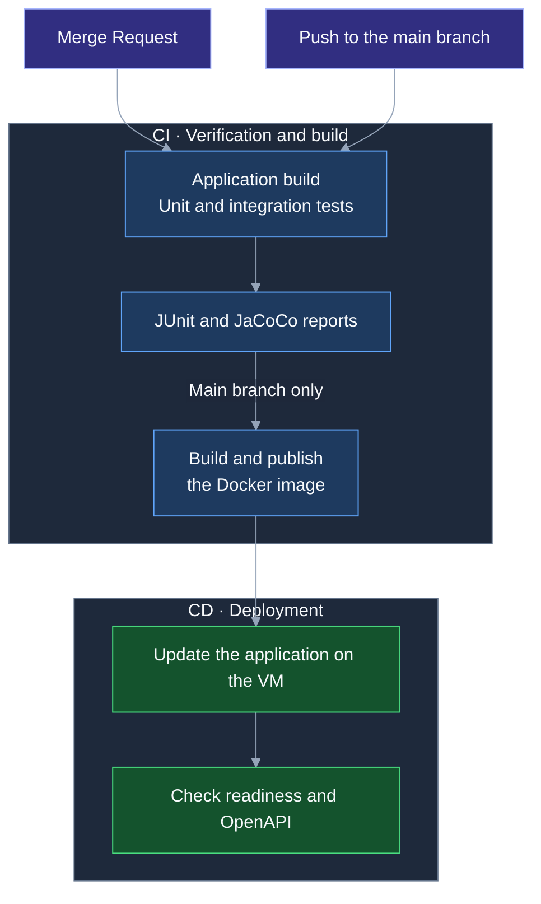

# Tests and reports

## Demo for the judges

On the first startup with an empty database, **`u1`–`u10` are created, all with password `1`**. Enter the username in the email field. The service account `admin` uses `ADMIN_PASSWORD`.

Each has two personal office moves and one shared move: `u1`–`u5` — the office moving from Ferrum, `u6`–`u10` — the office on the Neva. A personal project has two rooms, two folders, four tasks, three boxes, and four item records. A shared project has six boxes covering all five statuses. There are lost items, linked tasks, and an empty box with a deferred inventory for independent testing.

The “Office move” template is available to every account. All projects are active. Restarting does not overwrite passwords or data for existing accounts and does not restore objects deleted by the judges.

The last name for `u1`–`u10` is “Employee”; for `admin`, it is “Administrator”. If demo accounts already exist with an empty last name, it is filled in on the next startup; a nonempty last name is preserved.

## Where to view the results

Results are available in [GitLab → Pipelines](https://gitlab.t-education.com/hack-led-01/backend/-/pipelines)
in the pipeline for the selected commit or MR.

- **Tests** — test execution results.
- **Job test → Job artifacts → Download** — an archive with coverage reports. Open the HTML files after extracting the archive.

| Report | File in the artifacts |
| --- | --- |
| Overall coverage | `target/site/jacoco/index.html` |
| Integration tests only | `target/site/jacoco-integration/index.html` |
| Unit tests only | `target/site/jacoco-unit/index.html` |
| JUnit results | `target/surefire-reports/`, `target/failsafe-reports/` |

## CI/CD



## Local verification

JDK 17 is required; integration tests require a running Docker instance. PostgreSQL is started through Testcontainers.

Integration scenarios cover participant access, task folders and assignments, item links, applying task sets, box statuses, first-day migration, and ML limits. The external LLM is replaced with a stub in tests.

Unit tests only:

```bash
./mvnw test
```

All tests:

```bash
./mvnw clean verify
```
