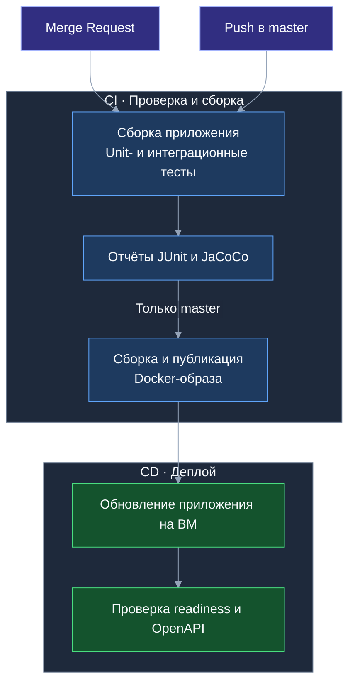

# Тесты и отчёты

## Где посмотреть результат

Результаты доступны в [GitLab → Pipelines](https://gitlab.t-education.com/hack-led-01/backend/-/pipelines)
в пайплайне выбранного коммита или MR.

- **Tests** — результаты выполнения тестов.
- **Job test → Job artifacts → Download** — архив с отчётами покрытия. HTML-файлы открываются после распаковки архива.

| Отчёт | Файл в артефактах |
| --- | --- |
| Общее покрытие | `target/site/jacoco/index.html` |
| Только интеграционные тесты | `target/site/jacoco-integration/index.html` |
| Только unit-тесты | `target/site/jacoco-unit/index.html` |
| Результаты JUnit | `target/surefire-reports/`, `target/failsafe-reports/` |

## CI/CD



## Локальная проверка

Только unit-тесты:

```bash
mvn test
```

Все тесты:

```bash
mvn clean verify
```

## ML-опись по фото

Оба маршрута — `item-description` и `items-description` — проверяются без обращения
к внешнему LLM. Для тестов и сборки образа `LLM_PROXY_API_KEY` не требуется.

| Проверки | Покрытие |
| --- | --- |
| HTTP-клиент с локальным HTTP-стабом | Отдельные промпты и JSON Schema, авторизация, передача изображения, таймауты включая чтение ответа, квота, ограничение размера ответа и ошибки прокси. |
| Валидатор описаний | Названия и метки, лишние поля, пустой список, один и 100 предметов, отклонение 101 элемента, сохранение порядка и одинаковых названий; один невалидный элемент отклоняет весь список. |
| Сервисы и API | Проверка владельца до вызова LLM, JWT, форматы и размер загрузки, отсутствие/несколько файлов, единый формат ошибок и отсутствие записи при распознавании. |
| Сохранение и миграции | Сохранение/редактирование меток, значения по умолчанию для существующих вещей и полный откат схемы. |

Запустить unit-тесты модуля распознавания:

```bash
./mvnw -Dtest=HttpLlmProxyClientTest,ItemDescriptionServiceTest,PhotoValidatorTest,ItemDescriptionValidatorTest test
```

Запустить unit-тесты и интеграционные проверки API вещей и миграций:

```bash
./mvnw -Dit.test=ItemApiIntegrationTest,LiquibaseMigrationIntegrationTest verify
```

Интеграционные проверки используют PostgreSQL через Testcontainers; в CI подключается
отдельный сервис PostgreSQL. Контракт одного главного предмета проверяется регрессионными тестами.
Ручная проверка качества на реальных фото и настройка ключа описаны в
[документации ML-описи](docs/photo-inventory.md).
