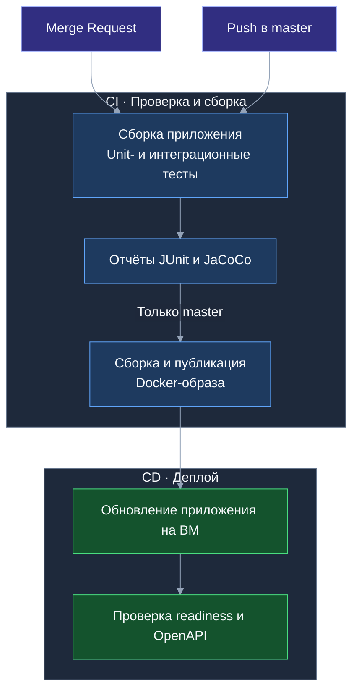

# Тесты и отчёты

## Где посмотреть результат

Результаты доступны в [GitLab → Pipelines](https://gitlab.t-education.com/hack-led-01/backend/-/pipelines)
в пайплайне выбранного коммита или MR.

- **Tests** — результаты выполнения тестов.
- **Job test → Job artifacts → Download** — архив с отчётами покрытия. HTML-файлы открываются после распаковки архива.

| Отчёт | Файл в артефактах |
| --- | --- |
| Общее покрытие | `target/site/jacoco/index.html` |
| Только интеграционные тесты | `target/site/jacoco-integration/index.html` |
| Только unit-тесты | `target/site/jacoco-unit/index.html` |
| Результаты JUnit | `target/surefire-reports/`, `target/failsafe-reports/` |

## CI/CD



## Локальная проверка

CI использует [настройки Maven](.ci/maven-settings.xml) с зеркалом Maven Central
в Google Cloud Storage. Это устраняет прямые скачивания с `repo.maven.apache.org`,
где общий исходящий адрес CI может получить `429 Too Many Requests`.
Локальная сборка без `-s` использует обычные настройки Maven.
Кэш `.m2/repository` сохраняется и после ошибки job (`cache:when: always`),
чтобы не терять уже скачанные зависимости.

Если Runner пишет `No URL provided, cache will not be downloaded from shared cache server`,
распределённый кэш не настроен. Его постоянное хранение между Kubernetes pod должен
настроить администратор Runner (общее хранилище или постоянный том); одной настройки
в `.gitlab-ci.yml` для этого недостаточно. Повторные запуски без паузы при 429
не устраняют ограничение. При наличии Maven-прокси площадки его URL можно указать
вместо публичного зеркала в `.ci/maven-settings.xml`.

`Non-resolvable parent POM` с HTTP 429 означает отказ загрузки до начала компиляции.
Предупреждения об отсутствии JUnit/JaCoCo/JAR в этом случае — следствие того,
что сборка ещё не дошла до создания этих файлов.

Только unit-тесты:

```bash
mvn test
```

Все тесты:

```bash
mvn clean verify
```

Проверки сроков и переноса даты переезда находятся в
`TaskRescheduleIntegrationTest`: UTC и смещения, выборочный пересчёт, FIXED и выполненные задачи,
полный отказ при ошибке, повторы, архив, доступ участников и конкурентное редактирование.
`MoveProjectBootstrapIntegrationTest` проверяет пустой план без выбора и явное применение шаблонов,
`LiquibaseMigrationIntegrationTest` — ограничения БД, сохранение дат старых задач и откат миграции.

Только эти интеграционные сценарии (также выполняются unit-тесты):

```bash
mvn -Dit.test=TaskRescheduleIntegrationTest,MoveProjectBootstrapIntegrationTest,LiquibaseMigrationIntegrationTest verify
```

`TaskSetIntegrationTest` проверяет личный CRUD, порядок, пагинацию, запрет чужого доступа,
копирование в RELATIVE-задачи, повторное и конкурентное применение, независимость копий,
мягкое удаление, атомарность создания с наборами, архив и применение участником общего проекта.
`DataLoaderIntegrationTest` проверяет явный выбор демо-набора без дублей при повторном запуске.
