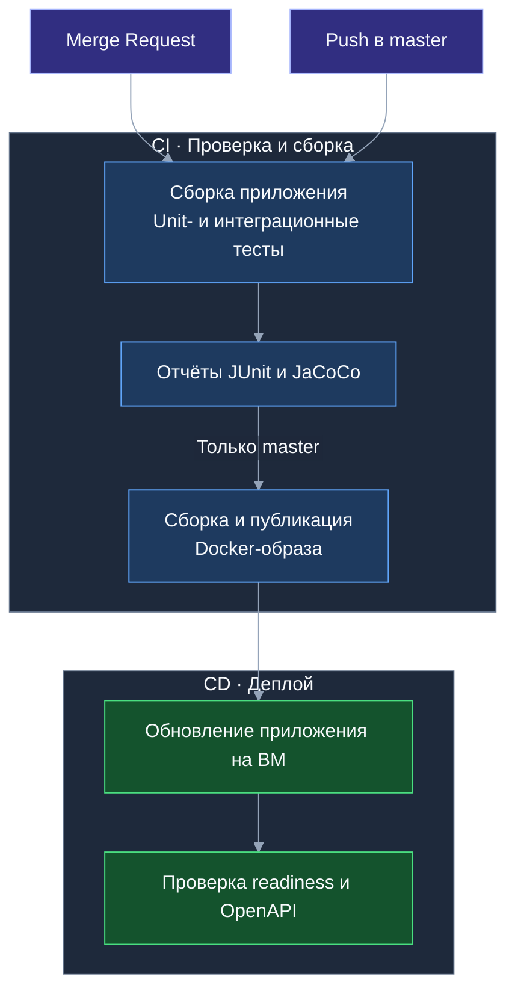

# Тесты и отчёты

## Где посмотреть результат

Результаты доступны в [GitLab → Pipelines](https://gitlab.t-education.com/hack-led-01/backend/-/pipelines)
в пайплайне выбранного коммита или MR.

- **Tests** — результаты выполнения тестов.
- **Job test → Job artifacts → Download** — архив с отчётами покрытия. HTML-файлы открываются после распаковки архива.

| Отчёт | Файл в артефактах |
| --- | --- |
| Общее покрытие | `target/site/jacoco/index.html` |
| Только интеграционные тесты | `target/site/jacoco-integration/index.html` |
| Только unit-тесты | `target/site/jacoco-unit/index.html` |
| Результаты JUnit | `target/surefire-reports/`, `target/failsafe-reports/` |

## CI/CD



## Локальная проверка

Только unit-тесты:

```bash
mvn test
```

Все тесты:

```bash
mvn clean verify
```

## Опись по фото

Тесты HTTP-клиента используют локальный HTTP-стаб: проверяются схема запроса, авторизация,
таймауты, квота и некорректные ответы. Интеграционные тесты подменяют LLM-клиент,
проверяют доступ по JWT, отсутствие записи при распознавании и сохранение/редактирование меток.
Миграционный тест проверяет добавление меток к существующей вещи и полный откат схемы.
Внешний LLM и API-ключ для CI не нужны.

Для списка предметов дополнительно проверяются отдельный промпт и JSON Schema, порядок и
повторяющиеся названия, границы 100/101 элементов, отказ всего ответа при невалидном элементе.
Проверки JWT и загрузки выполняются для обоих маршрутов; контракт одного предмета остаётся
под регрессионными тестами. Внешний LLM не вызывается.
