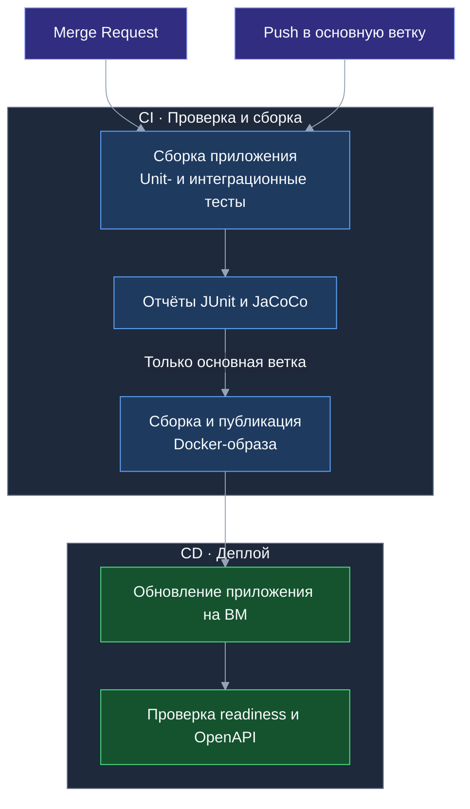

# Тесты и отчёты

## Демо для жюри

При первом запуске с пустой БД создаются **`u1`–`u10`, пароль у всех `1`**. Логин вводится в поле email. Служебный `admin` использует `ADMIN_PASSWORD`.

У каждого два личных офисных переезда и один общий: `u1`–`u5` — офис из Феррума, `u6`–`u10` — офис на Неве. В личном проекте две комнаты, две папки, четыре задачи, три коробки и четыре записи вещей. В общем — шесть коробок со всеми пятью статусами. Есть потерянные вещи, связанные задачи и пустая коробка с отложенной описью для самостоятельной проверки.

Шаблон «Переезд офиса» доступен каждому аккаунту. Все проекты активны. Повторный запуск не перезаписывает пароли и данные существующих аккаунтов и не восстанавливает удалённые жюри объекты.

У `u1`–`u10` фамилия — «Сотрудник», у `admin` — «Администратор». Если демо-аккаунты уже существуют с пустой фамилией, она заполняется при следующем запуске; непустая фамилия сохраняется.

## Где посмотреть результат

Результаты доступны в [GitLab → Pipelines](https://gitlab.t-education.com/hack-led-01/backend/-/pipelines)
в пайплайне выбранного коммита или MR.

- **Tests** — результаты выполнения тестов.
- **Job test → Job artifacts → Download** — архив с отчётами покрытия. HTML-файлы открываются после распаковки архива.

| Отчёт | Файл в артефактах |
| --- | --- |
| Общее покрытие | `target/site/jacoco/index.html` |
| Только интеграционные тесты | `target/site/jacoco-integration/index.html` |
| Только unit-тесты | `target/site/jacoco-unit/index.html` |
| Результаты JUnit | `target/surefire-reports/`, `target/failsafe-reports/` |

## CI/CD



## Локальная проверка

Нужен JDK 17; для интеграционных тестов — работающий Docker. PostgreSQL запускается через Testcontainers.

Интеграционные сценарии включают доступ участников, папки и назначения задач, связи с вещами, применение наборов, статусы коробок, миграцию первого дня и лимиты ML. Внешний LLM в тестах заменяется заглушкой.

Только unit-тесты:

```bash
./mvnw test
```

Все тесты:

```bash
./mvnw clean verify
```
