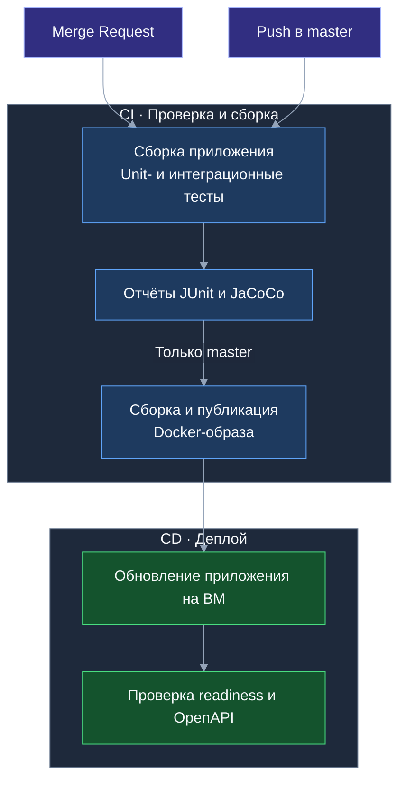

# Тесты и отчёты

## Где посмотреть результат

Результаты доступны в [GitLab → Pipelines](https://gitlab.t-education.com/hack-led-01/backend/-/pipelines)
в пайплайне выбранного коммита или MR.

- **Tests** — результаты выполнения тестов.
- **Job test → Job artifacts → Download** — архив с отчётами покрытия. HTML-файлы открываются после распаковки архива.

| Отчёт | Файл в артефактах |
| --- | --- |
| Общее покрытие | `target/site/jacoco/index.html` |
| Только интеграционные тесты | `target/site/jacoco-integration/index.html` |
| Только unit-тесты | `target/site/jacoco-unit/index.html` |
| Результаты JUnit | `target/surefire-reports/`, `target/failsafe-reports/` |

## CI/CD



## Локальная проверка

Только unit-тесты:

```bash
mvn test
```

Все тесты:

```bash
mvn clean verify
```

## ML-опись по фото

Маршруты `/api/ml/item-description`, `/api/ml/items-description` и `boxes/{boxId}/unpacking-verification` проверяются без обращения
к внешнему LLM. Для тестов и сборки образа `LLM_PROXY_API_KEY` не требуется.

| Проверки | Покрытие |
| --- | --- |
| HTTP-клиент с локальным HTTP-стабом | Отдельные промпты и JSON Schema, авторизация, передача изображения, таймауты включая чтение ответа, квота, ограничение размера ответа и ошибки прокси. |
| Валидатор описаний | Названия и метки, лишние поля, пустой список, один и 100 предметов, отклонение 101 элемента, сохранение порядка и одинаковых названий; один невалидный элемент отклоняет весь список. |
| Сервисы и API | Распознавание доступно с JWT без проекта; прежние URL удалены. JWT, форматы и размер загрузки, отсутствие/несколько файлов, единый формат ошибок и отсутствие записи при распознавании. Проверка владельца до вызова LLM сохраняется для сверки распаковки. |
| Сохранение и миграции | Сохранение/редактирование меток, значения по умолчанию для существующих вещей и полный откат схемы. |

Запустить unit-тесты модуля распознавания:

```bash
./mvnw -Dtest=HttpLlmProxyClientTest,ItemDescriptionServiceTest,PhotoValidatorTest,ItemDescriptionValidatorTest test
```

Запустить unit-тесты и интеграционные проверки API вещей и миграций:

```bash
./mvnw -Dit.test=ItemApiIntegrationTest,LiquibaseMigrationIntegrationTest verify
```

Интеграционные проверки используют PostgreSQL через Testcontainers; в CI подключается
отдельный сервис PostgreSQL. Контракт одного главного предмета проверяется регрессионными тестами.
Сценарии и ограничения ML описаны в [реализации требований](docs/requirements.md).

## Сверка распаковки по фото

- `UnpackingInventoryServiceTest`: порядок `createdAt, id`, неизменяемый снимок,
  проверка доступа и коробки, границы 0/100/101 вещей без обрезания списка.
- `UnpackingVerificationServiceTest`: полное/частичное совпадение и отсутствие совпадений,
  формирование `notSeen` из снимка, исходные названия и отсутствие вызова LLM при ошибках.
- `UnpackingVerificationValidatorTest`: отдельные одинаковые экземпляры, неоднозначные
  соответствия с `itemId=null`, чужие/повторные UUID, некорректные поля, лимиты,
  отказ модели и обрезанный ответ; ошибка отклоняет весь ответ.
- `HttpLlmProxyClientTest`: отдельные промпт и JSON Schema, одна фотография и опись в одном
  запросе, общий таймаут/перегрузка/ошибки и метрики `scenario=unpacking`.
- `UnpackingSnapshotIntegrationTest`: завершение транзакции до вызова LLM и сохранение
  исходного снимка при изменении вещи во время сверки.
- `ItemApiIntegrationTest`: JWT и доступ к коробке, все статусы коробки, ограничения описи
  и multipart, ошибки LLM, отсутствие изменений коробки, вещей и журнала событий.

```bash
./mvnw -Dtest=UnpackingInventoryServiceTest,UnpackingVerificationServiceTest,UnpackingVerificationValidatorTest,HttpLlmProxyClientTest test
./mvnw -Dit.test=ItemApiIntegrationTest,UnpackingSnapshotIntegrationTest verify
```

Автотесты используют стаб или mock LLM; ключ не нужен. Проверки синонимов и запрета
принудительного сопоставления в HTTP-тестах проверяют контракт промпта и ответа,
а не фактическую точность модели. Качество на реальных фотографиях оценивается отдельно.

## Планирование упаковки комнаты

- `RoomPackingPlanServiceTest`: текст, фото и сочетание; удаление крайних пробелов,
  лимит 4000 символов, обязательный источник, проверка фото до вызова LLM.
- `RoomPackingPlanValidatorTest`: сумма коробок, несколько групп, порядок действий,
  действия `donate`/`discard` и пустой список кандидатов; типы, обязательные/лишние поля,
  положительные целые количества, лимиты каждого списка и строк, отказ модели.
- `HttpLlmProxyClientTest`: отдельный промпт и строгая схема; один запрос для каждого
  варианта ввода, отсутствие изображения для текста; таймаут чтения, перегрузка,
  ограничение ответа и метрики `scenario=room_packing`.
- `RoomPackingPlanApiIntegrationTest`: JWT пользователя без проектов, JSON/multipart,
  границы ввода, единые ошибки, оба формата в OpenAPI; отсутствие изменений проектов,
  комнат, коробок, вещей и журнала событий при успешном ответе и ошибке LLM.

```bash
./mvnw -Dtest=RoomPackingPlanServiceTest,RoomPackingPlanValidatorTest,HttpLlmProxyClientTest test
./mvnw -Dit.test=RoomPackingPlanApiIntegrationTest,ItemApiIntegrationTest,UnpackingSnapshotIntegrationTest verify
```

Внешний LLM в автотестах заменён стабами. Тесты проверяют формат и правила промпта,
а не точность оценки количества коробок или качество рекомендаций на реальных комнатах.

## Мониторинг Sage

| Проверки | Покрытие |
| --- | --- |
| Авторизация метрик | `ObservabilityIntegrationTest`: настоящий endpoint Prometheus доступен с отдельным scrape-токеном; отсутствие токена, неверное значение, пользовательский JWT и POST отклоняются. Scrape-токен не открывает пользовательское API; readiness и вход по JWT сохраняются. `SecurityIntegrationTest` проверяет закрытый доступ при отсутствии настройки токена. |
| HTTP-логи | `RequestLoggingFilterTest`: JSON разбирается, содержит статус, длительность, шаблон маршрута и уникальный `requestId`, включая ответы 401/403 и необработанное исключение. Проверяются восстановление MDC и отсутствие тела запроса, токена и исходного URL с идентификатором. |
| Метрики LLM | `HttpLlmProxyClientTest`: учёт успеха, таймаута, перегрузки, некорректного ответа и ошибки прокси; перенос `requestId` в рабочий поток и очистка контекста. При игнорировании отмены активность сохраняется до фактического завершения, без второго учёта успеха. |

Unit-проверки наблюдаемости:

```bash
./mvnw -Dtest=RequestLoggingFilterTest,HttpLlmProxyClientTest test
```

Unit-тесты и интеграционные проверки авторизации:

```bash
./mvnw -Dit.test=ObservabilityIntegrationTest,SecurityIntegrationTest verify
```

Интеграционные проверки требуют PostgreSQL (Testcontainers локально либо внешний
тестовый сервер в CI). Доступ к Sage, рабочие токены и внешний LLM для них не нужны.
`ObservabilityIntegrationTest` сохраняет снимок endpoint в
`target/observability/scrape.prom`; это артефакт тестового запуска.

Приём данных вашей группой Sage проверяется отдельно после настройки target:
см. [руководство мониторинга](docs/observability.md). Тесты приложения не проверяют
внешние права, сетевой доступ сборщика, панели и доставку уведомлений Sage.
