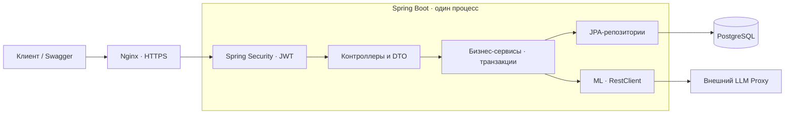

# Архитектура backend

## Структура

Модульный монолит: одно Spring Boot-приложение, пакеты по предметным областям.
Для масштаба MVP это позволяет выполнять связанные изменения одной транзакцией
и не требует отдельных сервисов, очередей и межсервисной синхронизации.

## Стек

- Java 17 / Spring Boot
- PostgreSQL / JPA / Liquibase
- Spring Security / JWT access + refresh
- Springdoc / Swagger

Схема БД обновляется SQL-миграциями Liquibase. Hibernate проверяет её соответствие сущностям через `ddl-auto=validate`.

## Пакеты

| Пакеты | Ответственность |
| --- | --- |
| [move](../src/main/java/ru/example/prodbackend/move), [room](../src/main/java/ru/example/prodbackend/room) | Проекты, проверка владельца, комнаты |
| [box](../src/main/java/ru/example/prodbackend/box), [item](../src/main/java/ru/example/prodbackend/item) | Коробки, статусы, содержимое, поиск и подсказки |
| [task](../src/main/java/ru/example/prodbackend/task), [checklist](../src/main/java/ru/example/prodbackend/checklist) | План, шаблоны, первый день |
| [ml](../src/main/java/ru/example/prodbackend/ml) | Опись одного или нескольких предметов по фотографии через LLM Proxy, без хранения фото |
| [event](../src/main/java/ru/example/prodbackend/event), [progress](../src/main/java/ru/example/prodbackend/progress) | История действий и сводки |
| [auth](../src/main/java/ru/example/prodbackend/auth), [user](../src/main/java/ru/example/prodbackend/user) | Вход, токены и профиль |
| [common](../src/main/java/ru/example/prodbackend/common), [exception](../src/main/java/ru/example/prodbackend/exception) | Пагинация и единый формат ошибок |

## Что прочитать дальше

| Вопрос | Документ |
| --- | --- |
| Где открыть API и пайплайны? | [README](../README.md) |
| Как реализованы требования на backend и в мобильном приложении? | [Реализация требований](requirements.md) |
| Где находятся отчёты и как запустить тесты? | [Тесты и отчёты](../TESTING.md) |

## ML-опись вещей по фото

Оба POST-маршрута находятся под `/api/move-projects/{projectId}/ml`:

| Маршрут | Ответ |
| --- | --- |
| `/item-description` | Один главный предмет: `name` и `flags` |
| `/items-description` | Объект `items` со списком из 1–100 описаний `name` и `flags` |

`ItemDescriptionController` принимает один multipart-файл `photo`.
`ItemDescriptionService` сначала проверяет владельца через `ProjectAccessService`, затем
размер и сигнатуру файла через `PhotoValidator`. Проверка доступа завершается до вызова LLM;
сетевое ожидание проходит вне транзакции БД.

`LlmProxyClient` отделяет сценарии от HTTP-протокола. `HttpLlmProxyClient` на Spring RestClient
использует отдельные промпты из ресурсов и строгие JSON Schema для одного предмета и списка.
В LLM Proxy отправляется изображение как base64 data URL. `ItemDescriptionValidator`
разбирает общий envelope ответа и проверяет названия и метки каждого предмета;
внутреннее поле модели `item` преобразуется в публичное `name`.
Некорректный элемент отклоняет весь список. Порядок модели и повторяющиеся названия сохраняются.

Оба сценария используют общий исполнитель: до четырёх одновременных обращений без очереди,
общий дедлайн по умолчанию 120 секунд и ограничение ответа прокси 64 КиБ.
Автоматических повторов нет. Ошибки интеграции преобразуются в единый `ErrorResponse`;
в логи не попадают фото, названия вещей, ключ и тела ответов прокси.

Распознавание не создаёт записей в БД и не хранит фотографии или историю результатов.
После проверки пользователем выбранные вещи сохраняются существующим `ItemService`.
Метки принадлежат домену `item`: enum `ItemFlag` представлен в JSON массивом `flags`,
а в PostgreSQL — колонками `fragile`, `first_day`, `carry_personally`.
Пакетный ввод `names` сохраняет только названия и оставляет метки пустыми.

Контракты, примеры запросов, ошибки и настройка: [Опись вещей по фотографии](photo-inventory.md).
