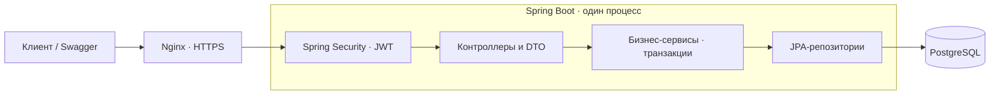

# Архитектура backend

## Структура

Модульный монолит: одно Spring Boot-приложение, пакеты по предметным областям.
Для масштаба MVP это позволяет выполнять связанные изменения одной транзакцией
и не требует отдельных сервисов, очередей и межсервисной синхронизации.

## Стек

- Java 17 / Spring Boot
- PostgreSQL / JPA / Liquibase
- Spring Security / JWT access + refresh
- Springdoc / Swagger

Схема БД обновляется SQL-миграциями Liquibase. Hibernate проверяет её соответствие сущностям через `ddl-auto=validate`.

Совместный доступ хранится в `project_participants` (миграция 0018), с уникальностью пары
проект/пользователь и индексом пользователя. Создатель имеет доступ через неизменный `owner_id`,
поэтому старые проекты не требуют заполнения таблицы. Роли внутри проекта не вводятся: права
создателя и участников одинаковые. Проверки и списки используют `owner_id = userId OR EXISTS (...)`;
это применяется и к запросам поиска вещей/подсказок, и к `countQuery` списка проектов без дубликатов.
Добавление участников блокирует проект, проверяет архив и сохраняет связь по UUID аккаунта.
Начальные участники создаются в транзакции проекта; неизвестный аккаунт откатывает всё создание.
Список участников загружает аккаунты одним `EntityGraph`, наружу возвращается отдельный DTO.
События коробок, задач, архивации и восстановления получают UUID действительного автора действия.

Все изменения существующего проекта и его содержимого сначала блокируют строку своего проекта
через `getAccessibleProjectForUpdate()`, проверяющий отсутствие архива. Для архивации и восстановления
используется `lockAccessibleProject()` без запрета архива. Обе проверки требуют уже открытой транзакции.
Единый порядок блокировок: проект → коробки (для переноса — по UUID) → остальные записи.
Это сериализует записи внутри одного проекта; для MVP такая простая защита исключает запись
после архивации и сохраняет независимость разных проектов. Чтение использует `getAccessibleProject()`
без блокировки и доступно для архивных проектов. Создание нового проекта выполняется в своей
транзакции, до фиксации он недоступен другим запросам.

Архив хранится в `move_projects.archived_at` (миграция 0017), boolean вычисляется в ответе.
Архивация/восстановление и соответствующее событие журнала фиксируются атомарно.
Проверка архива находится в начале каждого изменяющего сервиса, включая собственный доступ
`ItemService`; записи нельзя выполнить после ожидания блокировки уже архивированного проекта.
Фильтрация списка по архиву и его countQuery используют одинаковые условия до пагинации.
Откат 0017 со старым CHECK типов событий отклоняется, если есть `PROJECT_ARCHIVED`/`PROJECT_RESTORED`:
история не удаляется и не переименовывается в другой тип. Проверка миграций отдельно проверяет
этот отказ и сохранение состояния; полный откат выполняется в изолированной тестовой схеме.

Изменение статуса коробки и операции с её вещами затем используют общую блокировку строки коробки
(`PESSIMISTIC_WRITE`). Проверка отметок и смена статуса выполняются в одной транзакции:
одновременное добавление вещи не позволяет закрыть коробку с неготовым содержимым.
Счётчики готовности вычисляются агрегатным запросом по записям вещей; для списка коробок
используется один групповой запрос по идентификаторам коробок текущей страницы.

Коррекция статуса — отдельная транзакционная операция с той же блокировкой коробки. Она проверяет
подтверждение, ожидаемый статус, направление назад и готовность содержимого до изменений.
Сброс распаковки выполняется одним UPDATE всех отмеченных вещей, с изменением их `updated_at`;
остальные поля сохраняются. Статус и событие `BOX_STATUS_CORRECTED` с `previous_status`/`new_status`
фиксируются атомарно. Повтор целевого статуса не меняет время и не добавляет событие.
Время коробки округляется до микросекунд PostgreSQL, чтобы исходный ответ и ответ повтора совпадали.
Миграция 0016 расширяет CHECK типов событий. При её откате записи коррекций сохраняются
как `BOX_STATUS_CHANGED` с прежними автором, временем и описанием; отдельные поля статусов удаляются.

Подпись и особенности коробки (`title`, `fragile`, `firstDay`, `carryWithMe`) хранятся в `boxes`,
чтобы одинаково читаться на разных устройствах. Миграция 0014 задаёт старым коробкам пустую подпись
и выключенные флаги. PATCH сохраняет отсутствующие поля и принимает явный `false`, но запрещает `null`.
Флаги коробки независимы от вещей, чек-листа и статусов; фильтры объединяются через И
в основном запросе списка и его `countQuery`, поэтому пагинация использует те же условия.

Выбранный значок хранится только в `rooms.icon_key` (необязательная строка до 64 символов).
Изображения принадлежат клиенту; сервер не определяет значок по имени и не фиксирует закрытый
список ключей. PATCH использует setter с признаком присутствия: пропущенное поле сохраняет
значок, переданный `null` очищает его. Ответы со сведениями о комнате читают `roomIconKey`
из связанной комнаты; существующие `EntityGraph` подгружают комнату для списков вещей,
коробок, подсказок и чек-листа, поэтому отдельный запрос для каждого значка не нужен.

Связь пункта первого дня с вещью хранится по UUID: уникальный внешний ключ с `ON DELETE SET NULL`
оставляет пункт при удалении вещи. Привязка и снятие `firstDay` блокируют сначала проект и коробку,
затем пункт чек-листа и меняют данные одной транзакцией. Список чек-листа загружает вещь,
коробку и комнату через `EntityGraph`, чтобы избежать запроса на каждый пункт.

Перенос меняет `box_id` существующей вещи одной транзакцией. Исходная и целевая коробки блокируются
в фиксированном порядке UUID, поэтому встречные переносы не создают цикл блокировок.
Расположение проверяется после блокировки. Привязка к чек-листу также сначала блокирует проект:
она ждёт завершения переноса и затем использует актуальную коробку. Дополнительная проверка
расположения после блокировки коробки сохраняется как защита от несогласованных внутренних вызовов.

## Пакеты

| Пакеты | Ответственность |
| --- | --- |
| [move](../src/main/java/ru/example/prodbackend/move), [room](../src/main/java/ru/example/prodbackend/room) | Проекты, участники, проверка доступа, комнаты |
| [box](../src/main/java/ru/example/prodbackend/box), [item](../src/main/java/ru/example/prodbackend/item) | Коробки, статусы, содержимое, поиск и подсказки |
| [task](../src/main/java/ru/example/prodbackend/task), [checklist](../src/main/java/ru/example/prodbackend/checklist) | План, шаблоны, первый день |
| [event](../src/main/java/ru/example/prodbackend/event), [progress](../src/main/java/ru/example/prodbackend/progress) | История действий и сводки |
| [auth](../src/main/java/ru/example/prodbackend/auth), [user](../src/main/java/ru/example/prodbackend/user) | Вход, токены и профиль |
| [common](../src/main/java/ru/example/prodbackend/common), [exception](../src/main/java/ru/example/prodbackend/exception) | Пагинация и единый формат ошибок |

## Что прочитать дальше

| Вопрос | Документ |
| --- | --- |
| Где открыть API и пайплайны? | [README](../README.md) |
| Как реализованы требования на backend и в мобильном приложении? | [Реализация требований](requirements.md) |
| Как добавить участников совместного переезда? | [Совместные проекты](shared-projects.md) |
| Где находятся отчёты и как запустить тесты? | [Тесты и отчёты](../TESTING.md) |
