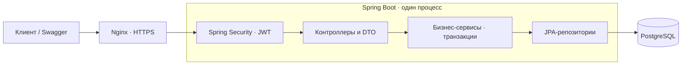

# Архитектура backend

## Структура

Модульный монолит: одно Spring Boot-приложение, пакеты по предметным областям.
Для масштаба MVP это позволяет выполнять связанные изменения одной транзакцией
и не требует отдельных сервисов, очередей и межсервисной синхронизации.

## Стек

- Java 17 / Spring Boot
- PostgreSQL / JPA / Liquibase
- Spring Security / JWT access + refresh
- Springdoc / Swagger

Схема БД обновляется SQL-миграциями Liquibase. Hibernate проверяет её соответствие сущностям через `ddl-auto=validate`.

## Пакеты

| Пакеты | Ответственность |
| --- | --- |
| [move](../src/main/java/ru/example/prodbackend/move), [room](../src/main/java/ru/example/prodbackend/room) | Проекты, проверка владельца, комнаты |
| [box](../src/main/java/ru/example/prodbackend/box), [item](../src/main/java/ru/example/prodbackend/item) | Коробки, статусы, содержимое, поиск и подсказки |
| [task](../src/main/java/ru/example/prodbackend/task), [checklist](../src/main/java/ru/example/prodbackend/checklist) | План, шаблоны, первый день |
| [event](../src/main/java/ru/example/prodbackend/event), [progress](../src/main/java/ru/example/prodbackend/progress) | История действий и сводки |
| [auth](../src/main/java/ru/example/prodbackend/auth), [user](../src/main/java/ru/example/prodbackend/user) | Вход, токены и профиль |
| [common](../src/main/java/ru/example/prodbackend/common), [exception](../src/main/java/ru/example/prodbackend/exception) | Пагинация и единый формат ошибок |

## Что прочитать дальше

| Вопрос | Документ |
| --- | --- |
| Где открыть API и пайплайны? | [README](../README.md) |
| Как реализованы требования на backend и в мобильном приложении? | [Реализация требований](requirements.md) |
| Где находятся отчёты и как запустить тесты? | [Тесты и отчёты](../TESTING.md) |
