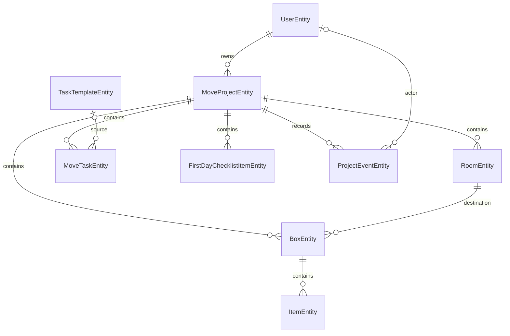

# Предметная модель MoverMate

Модель основана на обязательных требованиях [MoverMate.md](../MoverMate.md), разделы 5 и 8,
и backend-критериях из [Критерии.md](../Критерии.md). Это слой хранения и минимальных
доменных правил; сервисы, API, заполнение справочников и ML в данную реализацию не входят.
Существующие сущности пользователей и refresh-токенов сохранены без изменений.

## Сущности и связи

| Сущность / таблица | Содержание |
| --- | --- |
| `MoveProjectEntity` / `move_projects` | Обязательные владелец, название и дата; адреса отправления и назначения необязательны |
| `RoomEntity` / `rooms` | Проект и непустое название комнаты назначения; уникальная пара `(project_id, name)` |
| `MoveTaskEntity` / `move_tasks` | Проект, название, этап; необязательные описание, календарный срок, имя ответственного, время выполнения и источник-шаблон |
| `TaskTemplateEntity` / `task_templates` | Уникальный код, название, этап, необязательные описание и смещение срока относительно даты переезда; порядок отображения |
| `BoxEntity` / `boxes` | Проект, комната, положительный номер, статус; признак отложенного ввода и необязательное время напоминания |
| `ItemEntity` / `items` | Коробка, непустое название и признак потери; одинаковые названия допустимы |
| `FirstDayChecklistItemEntity` / `first_day_checklist_items` | Проект, название предмета, порядок отображения и необязательное время отметки выполнения |
| `GuideEntity` / `guides` | Уникальный код, заголовок, текст и порядок отображения; памятки хранятся в БД |
| `ProjectEventEntity` / `project_events` | Проект, необязательный инициатор, тип события, тип и UUID объекта, описание и время события |

Ответственный — свободное имя, регистрация ему не нужна. Совместный доступ к проекту
не реализован. Предмет чек-листа первого дня не обязан уже находиться в коробке.
Список вещей хранит отдельные записи с названиями: количество и единицы измерения не вводятся.

## Ограничения и поведение

- Новые сущности используют UUID. `AuditedEntity` добавляет изменяемым записям
  `createdAt` и `updatedAt` через `@PrePersist` / `@PreUpdate`; у событий есть только `occurredAt`.
  Массовые SQL/JPQL-обновления обходят lifecycle callbacks, поэтому при их добавлении время
  изменения потребуется обновлять явно.
- Даты переезда и сроков задач — `LocalDate`; отметки выполнения, аудит и напоминания — `Instant`.
  Все enum хранятся строками, без зависимости от номера значения в перечислении.
- Этапы: `BEFORE_MOVE`, `MOVING_DAY`, `AFTER_MOVE`. Отсутствие `completedAt` означает,
  что задача или пункт чек-листа ещё не выполнены.
- Коробка начинается со статуса `PACKING`. `changeStatus` разрешает только последовательность
  `PACKING → PACKED → LOADED → DELIVERED → UNPACKED` и повтор текущего статуса.
  Пропуск этапа, возврат и `null` вызывают `IllegalArgumentException`, сохраняя прежний статус.
  Публичного setter статуса нет. Прямой SQL обходит этот метод.
- Номер коробки уникален внутри переезда: `UNIQUE (project_id, number)`.
  Комната и проект задаются явно, а составной FK `boxes(room_id, project_id) → rooms(id, project_id)`
  исключает несовпадение проектов на уровне PostgreSQL. Для него в `rooms` есть дополнительный
  уникальный ключ `(id, project_id)`. В JPA FK задан через `foreignKeyDefinition`, чтобы
  обе обычные связи оставались записываемыми без смешанного `insertable` в составной связи.
- Номер коробки проверяется Bean Validation и SQL CHECK `number > 0`.
  Названия и коды проверяются на непустоту, строки имеют ограничения длины;
  обязательные столбцы и связи защищены `NOT NULL` и внешними ключами.
  Непустота строк проверяется Bean Validation; SQL-запись в обход ORM её не проверяет.
  Название комнаты уникально в точном сохранённом виде, без нормализации регистра и пробелов.
- Родительские связи — `LAZY`, без каскадов и обратных коллекций. Создавать родителей
  нужно до детей; удаление связанных записей будущие сервисы должны выполнять явно.
  Удаление пользователя, проекта, комнаты или шаблона с зависимостями блокируется FK.
- Пустое содержимое не включает отложенное заполнение автоматически. Напоминание только
  хранится: доставка уведомлений появится в сервисном слое.
- Задача хранит собственные название, описание, этап и срок. При создании из шаблона будущий
  сервис копирует значения и вычисляет срок по смещению; редактирование шаблона не меняет задачу.
- События: `PROJECT_CREATED`, `BOX_CREATED`, `BOX_STATUS_CHANGED`, `TASK_COMPLETED`.
  Объекты: `PROJECT`, `BOX`, `TASK`. Ссылка на объект — UUID без FK: после удаления коробки
  или задачи запись журнала сохраняется. Сам проект и инициатор связаны обычными FK.
  Генерация событий и согласованность пары «тип события — тип объекта» относятся к сервисам.

## Соответствие ТЗ и границы реализации

| Требование | Поддержка модели / дальнейшая работа |
| --- | --- |
| 5.1. Проекты, этапы и задачи | Проект, задачи, шаблоны и имя ответственного; генерация задач из шаблонов — будущий сервис |
| 5.2. Коробки и инвентарь | Коробки, комнаты, вещи, отложенный ввод; подтверждение удаления — будущий пользовательский сценарий |
| 5.3. Поиск и этикетки | UUID коробки — идентификатор для QR-ссылки; номер читается в контексте проекта. Генерация QR/PDF и запросы поиска не реализованы |
| 5.4. Контроль и распаковка | Статусы, отметки выполнения, чек-лист первого дня и признак потери; прогресс и подсказки вычисляются будущими запросами |
| 5.5. Памятки | `GuideEntity` хранит локальные материалы в БД; начальное содержимое пока не загружается |
| 8. Надёжность и наблюдаемость | Уникальность, FK, переходы статуса и схема событий; автоматическая запись журнала появится в сервисах |

Индексы покрывают внешние ключи, пару «проект — статус», название вещи и пару «проект — время события».
Индекс названия не гарантирует ускорение произвольного поиска по подстроке: стратегию поиска,
пагинацию и стабильную сортировку нужно определить при реализации репозиториев.
Отдельные сущности этикеток, QR-кодов, прогресса и результатов поиска не нужны.

Сохранена согласованная граница задачи: `ddl-auto=create` в профилях dev/prod не изменён.
При перезапуске приложения таблицы по-прежнему пересоздаются. Для выполнения требования
сохранности данных нужна отдельная работа по миграциям; текущая модель не устраняет это ограничение.
Данный документ описывает предметную модель, а не полный документ архитектурных решений
по всем этапам, требуемым критериями оценивания.

## Проверка

- `BoxEntityTest`: все пары статусов, включая `null`, повтор текущего статуса и начальные значения.
- `DomainModelIntegrationTest`: PostgreSQL 17 в Testcontainers, сохранение и повторная загрузка
  всех сущностей, ленивые связи, строковые enum, аудит, независимость текста задачи от шаблона,
  уникальные номера/коды/комнаты, обязательные поля, положительные номера, FK и сохранение
  события после удаления коробки. Каждый тест откатывает свою транзакцию.
- `./mvnw test` — unit-тесты; `./mvnw verify` — полный набор, включая существующие
  сценарии аутентификации, и отчёты JaCoCo в `target/site/`.

Подробности запуска и расположение отчётов: [TESTING.md](../TESTING.md).
